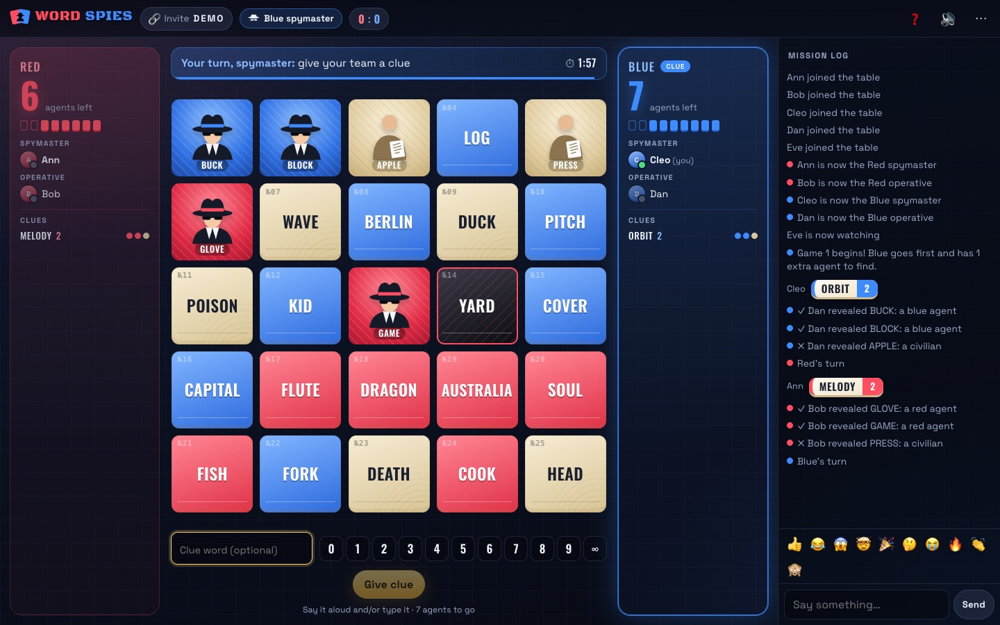
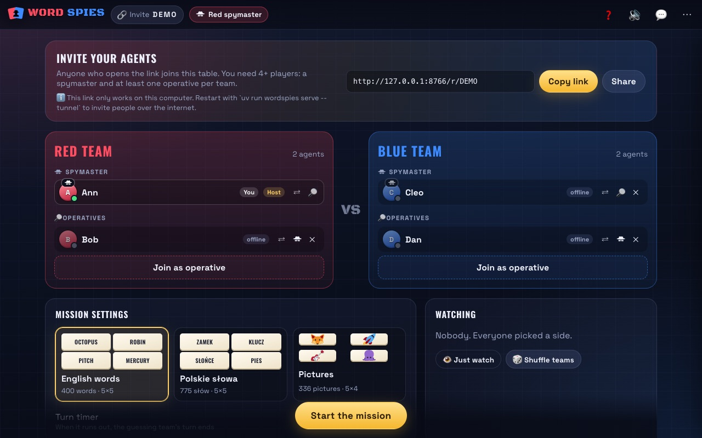
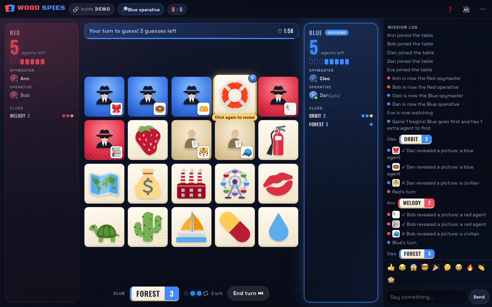

# Codenames

A team word-association spy game for the browser, made for playing with friends over voice chat (Discord, a
call, or the same room). One person runs a small Python server and everyone else opens a link.



## Features

- **Two teams, two roles.** Each team has a spymaster, who sees the secret key, and operatives, who don't. The
  server holds the key and only sends it to spymasters until the game ends.
- **The rules are enforced.** A clue with number *N* allows up to *N + 1* guesses. A clue of 0 or ∞ allows any
  number. Players must guess at least once before ending the turn. A miss ends the turn, the assassin loses the
  game, and a team wins when all its agents are revealed.
- **Three decks, chosen in the lobby:** 400 English words, 400 Polish words (both on a 5×5 grid), or 280 pictures
  (5×4 grid). You can also add a folder of your own images.
- **Made for voice chat.** The spymaster says the clue out loud and enters the number; typing the word is optional.
  Operatives click a card to point at it (everyone sees who points where) and click it again to reveal it.
- **Animations and sound:** cards are dealt and flip in 3D, revealed agents burst into sparks, the assassin shakes
  the screen, turn changes sweep across the board, and the winners get confetti. All sounds are synthesised.
- **Works at any size**, from a phone in portrait to an ultrawide monitor, and in a browser window that isn't
  full screen. The board always fits without scrolling.
- **Table extras:** a mission log with every clue and guess, chat and emoji reactions, an optional turn timer, a
  running score across games, reconnecting, moving your seat to another device, and automatic host hand-over.

| Lobby | Picture deck |
| --- | --- |
|  |  |

## Requirements

- [uv](https://docs.astral.sh/uv/getting-started/installation/). It installs Python 3.12 and all dependencies.
- Optional: [cloudflared](https://developers.cloudflare.com/cloudflare-one/connections/connect-networks/downloads/),
  to invite friends from outside your network (`brew install cloudflared` on macOS).

## Quick start

```bash
git clone https://github.com/dmytro-mz/codenames.git
cd codenames
uv run codenames serve --tunnel
```

Open <http://localhost:8000> and click **Create a table**. Send the invite link to your friends: it's at the top
of the lobby, and the **🔗 Invite** chip in the top bar copies it at any time. Split into teams, pick a deck, and
start.

### Inviting friends

| Command | Who can join |
| --- | --- |
| `uv run codenames serve` | People on the same Wi-Fi/LAN, through the network link printed at startup |
| `uv run codenames serve --tunnel` | Anyone, through a temporary public `trycloudflare.com` link |
| `uv run codenames serve --test` | Just you: adds fake players and a bar to switch between seats, to try every role yourself |
| `uv run codenames serve --public-url https://…` | Anyone, if you host the server behind your own domain or reverse proxy |
| `uv run codenames serve --pictures ~/my-images` | Adds a "My pictures" deck from a folder of at least 20 images |

Run `uv run codenames serve --help` for all options.

## How to play

You need at least 4 players: one spymaster and at least one operative on each team. The team that starts has one
extra agent to find (9 against 8 with words, 8 against 7 with pictures). The rest of the cards are civilians,
plus one assassin.

1. **The spymaster** says one word and a number, for example "ocean 2", that connects that many of the team's
   cards, and enters it in the game. The word can't be one of the words on the table.
2. **Operatives** talk it over and reveal cards one at a time. Click a card to point at it, then click it again
   to reveal it.
   - Your own agent: keep guessing, up to *number + 1* guesses.
   - A civilian or an enemy agent: your turn ends.
   - The assassin: your team loses immediately.
3. After at least one guess the team may **end the turn**. With an optional turn timer, the guessing team's turn
   ends when time runs out.

The first team with all its agents revealed wins, even if the other team revealed the last one.

**Host controls (lobby):** shuffle the teams, move players between teams and roles, choose the deck, and set the
turn timer. **⋯ → Continue on another device** gives you a personal link to move to another device, such as your
phone.

## Development

```bash
uv sync                                                     # install runtime + dev dependencies
uv run pytest                                               # rules, permissions, hidden key, timer, HTTP/WebSocket
uv run ruff check --fix src tests scripts && uv run ruff format src tests scripts
```

The browser checks drive Google Chrome through Playwright. They expect Chrome at the default macOS path, set by
`CHROME` in `scripts/demo.py`:

```bash
uv run python scripts/demo.py --stage guess --as spy --size 1440x900,390x844   # screenshots (lobby|clue|guess|over|home)
uv run python scripts/ui_check.py                                               # 4 browsers play 2 games by clicking
```

### Project layout

```
src/codenames/
  game/      rules engine (pure, no I/O) and decks; data/ holds the word lists
  web/       room logic, FastAPI + WebSocket server, and the vanilla JS client in static/ (no build step)
  cli.py     the `codenames` command
scripts/     screenshots, the browser playthrough, and the picture-deck downloader
tests/       pytest suite
```

The server owns the game state and checks every move. Clients only send what a player wants to do and receive a
snapshot filtered for them, so operatives never receive the key before the game ends.

## License and credits

The code is released under the [MIT License](LICENSE).

- English word list: [Gullesnuffs/Codenames](https://github.com/Gullesnuffs/Codenames) (`wordlist-eng.txt`).
- Polish word list: [sagelga/codenames](https://github.com/sagelga/codenames) (`wordlist/pl-PL/default`); underscores
  in multi-word entries are turned into spaces.
- Picture deck: card images from [samdemaeyer/codenames-pictures](https://github.com/samdemaeyer/codenames-pictures/tree/main/public/images/cards).
- Fonts: Black Ops One, Oswald and Space Grotesk from Google Fonts (SIL Open Font License).

Codenames uses the classic spymaster-and-operatives rules of word-association party games, with its own
artwork. It is an unofficial fan project for private games with friends, and is not affiliated with or endorsed by
any publisher.
